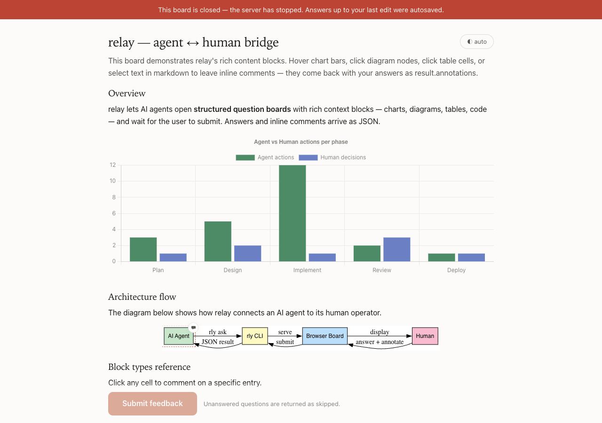

# Relay

Relay gives your AI coding agent a board for showing work and asking for
feedback. Review a design, compare a diff, or answer several questions in one
place, in your browser or inside a chat app that supports MCP Apps.

Feedback stays attached to the thing you mean: a chart point, a line of text,
or a marked area of an image. When you submit, the agent gets your choices
and comments as structured JSON, including the target of each comment.
It works with agents such as Claude Code and Codex.



## Install and try it

Requires Node.js 20 or newer.

```sh
npm i -g @khanglvm/relay
rly ask -q "Which layout?::single::Sidebar,Top navigation"
```

A board opens in your browser. Choose an option and submit to see the result
in your terminal.

You can also open local files or review changes from a Git repository:

```sh
rly view README.md
rly diff --staged
```

## What you can review

- Plans, documents, charts, and diagrams.
- Images and HTML prototypes, with comments on individual elements or areas.
- Source files and diffs, including commit choices and merge conflicts.
- Questions with choices, notes, and other form controls.

- Small live widgets such as status lists, numbers, progress bars and buttons, written in [A2UI](docs/A2UI.md).

Answers and comments autosave. To stop a board, run `rly list` to find its
ID, then `rly stop <board-id>`.

## For AI agents

Install the skill so your agent knows how to create boards and read feedback:

```sh
npx skills add khanglvm/relay --skill relay --all
```

Give your agent this instruction:

```text
Use Relay to show work or collect visual feedback. Install the CLI with
`npm i -g @khanglvm/relay` if missing. Run `rly agent` for the board format.
Create with `rly ask --file spec.json --detach`, then use `rly wait <board-id>`
to collect answers. On timeout, check `rly result <board-id>` before continuing.
```

To make this a standing preference, `rly install --target codex` adds Relay
rules to Codex's instruction file. Run `rly install` to see other targets.

## Open a board on your phone

A board listens on this machine only until you give it a link. Two generic ways:

- A URL template for any proxy or tunnel you run: `--public-url 'https://host.example.com:{port}'`.
- A link-provider command: `--link-command 'my-publisher {port}'`. Relay runs it with the
  board's port; it prints an https URL (plain text, or JSON with `url`), and the board is
  served at that origin. Set `RLY_LINK_RELEASE_COMMAND` to a command that runs when the
  board closes. Commands are split on spaces and run without a shell.

[`devlink`](https://github.com/khanglvm/devlink) is one such provider and has a shortcut:
`--devlink`. Run `rly config link <off|auto|devlink|url|command:CMD>` to make a choice the
default. The details are in the [agent guide](docs/AGENT.md).

## More help

- [Setup and MCP Apps](docs/SETUP.md): agent configuration, in-chat boards, sharing, and updates.
- [A2UI widgets](docs/A2UI.md): the `a2ui` block, also available as `rly a2ui`.
- [Agent guide](docs/AGENT.md): board examples, block types, and JSON schemas; also available as `rly agent`, with `rly agent <topic>` for one part and `rly schema <type>` for one block or question type.
- `rly help` lists commands. `rly upgrade` updates the CLI and skill.
- [Changelog](CHANGELOG.md) · [MIT license](LICENSE)

For development, clone the repo and run `npm test`. The smoke tests use local
servers and do not require external services.
